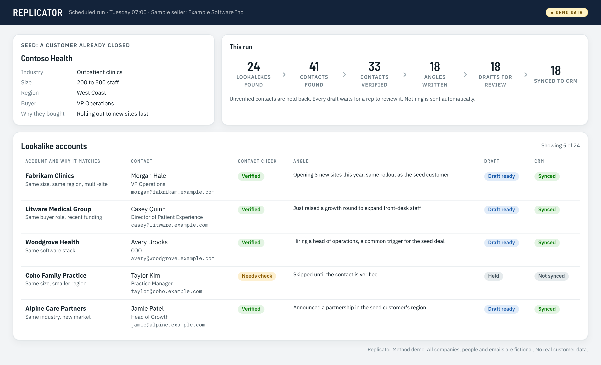
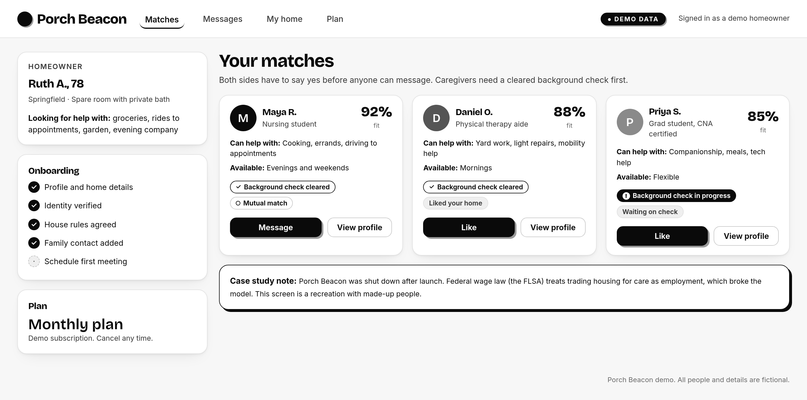

# Lucas Walsh

I'm a junior at Tulane University's A. B. Freeman School of Business, with a dual major in Finance and Management. GPA 3.81. I graduate in May 2028. I'm from San Francisco.

I'm looking for a summer 2027 internship in GTM, RevOps or business operations, in San Francisco, New York or Boston.

- LinkedIn: [linkedin.com/in/lucas-d-walsh](https://www.linkedin.com/in/lucas-d-walsh)
- Email: lucaswalsh90@gmail.com

This repo is a short tour of things I've built. I build by directing AI tools. Each project below has its own page with more detail.

## Projects

### [Replicator Method](projects/replicator-method.md)

Proto Hologram, summer 2026. An AI sales workflow I built by directing Claude and Apollo. It runs on a schedule. It takes a customer the company has already closed, finds lookalike companies, verifies contacts, writes an angle for each account, drafts the outreach and syncs the leads into HubSpot. A person reviews every email. I improved it twice a week with the CTO and the sales reps.

### [Porch Beacon](projects/porch-beacon.md)

Summer 2026. A two-sided marketplace matching older homeowners with caregivers. I built it with AI tools and deployed it. Then I found that federal wage law treats trading housing for care as employment. So I shut it down and wrote a case study.

### [Castle Desk and Lead Desk](projects/castle-desk.md)

2026, ongoing. An AI lead engine for a small family business. It syncs leads, pulls call results from an AI voice agent, runs a daily lead radar and prepares draft outreach. A person approves everything before it goes out. I also made a general version, Lead Desk, that any small business can run with its own profile.

- [Try the Lead Desk demo](https://lucaswalsh90-ctrl.github.io/portfolio/) (click-through, fictional data)
- Code available on request.

## How I work with AI

- I start from the workflow people already use, not from the tool.
- A human reviews anything that reaches a customer.
- I test with the people who use the output, and change it based on what they actually use.
- I check the rules early. If the evidence says stop, I stop.
- Private data stays private. These pages describe the systems, not the data or code behind them. All screenshots use made-up demo data.
