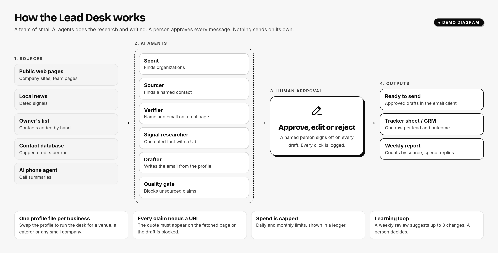
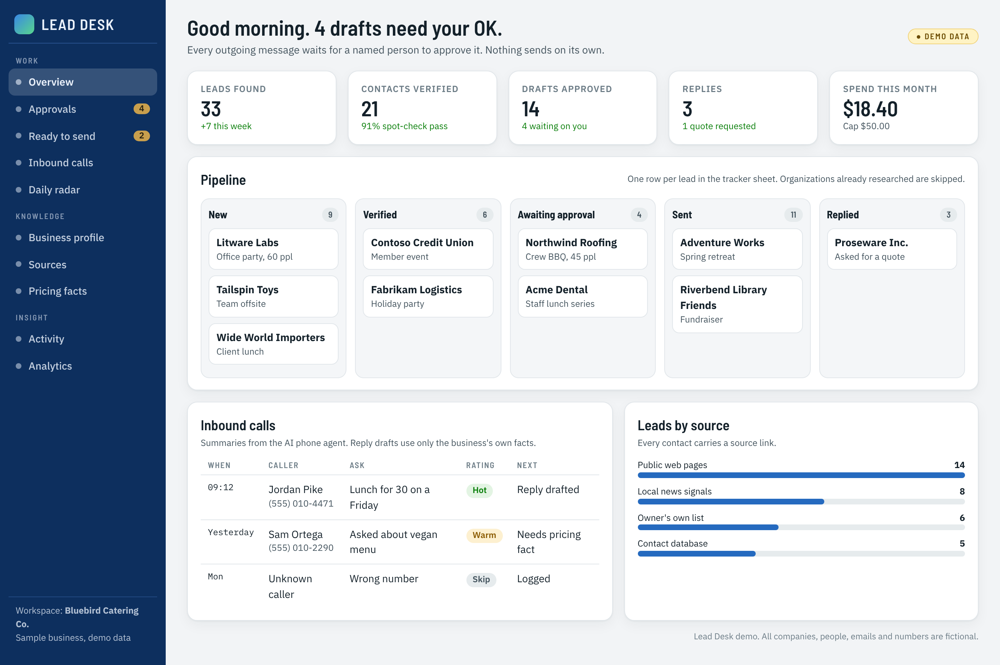
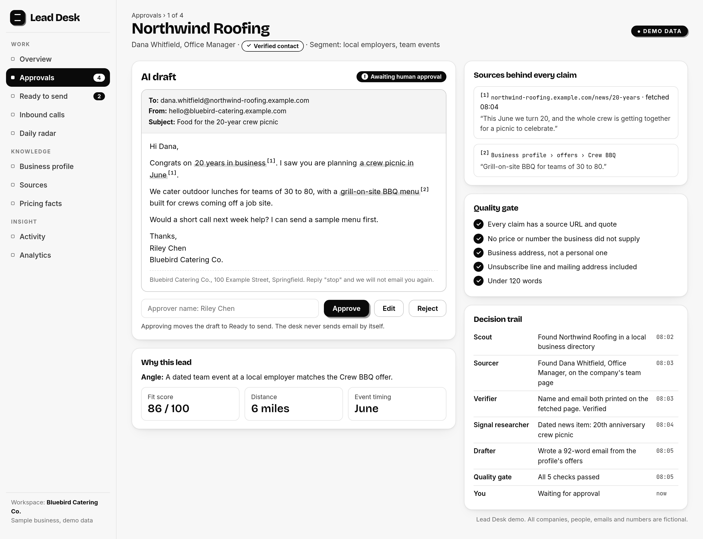
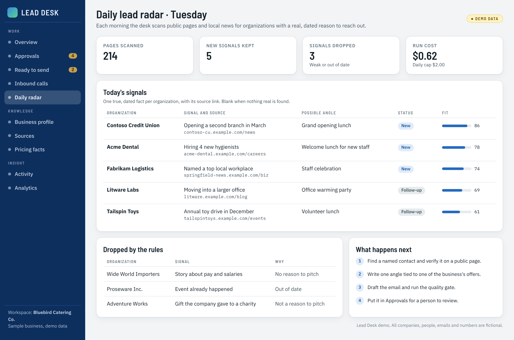

# Castle Desk, and the general Lead Desk

2026, ongoing. Built for a small family business.

## What it is

An AI lead engine for a small business. It helps find and follow up on leads, and a person approves every outreach before it goes anywhere.

I built the first version for a family business. The design works for most small companies, so I also made a general version called Lead Desk. Each business gets one profile file with its offers, target customers and rules. Swap the profile and the same desk runs for a caterer, a venue or a local service company.

The screens below show Lead Desk with a made-up business and made-up leads. No real data is shown.

## What it does

- Syncs leads into one place.
- Pulls in call results from an AI voice agent that answers the phone.
- Runs a daily lead radar to surface new prospects.
- Prepares draft outreach for human approval. It never sends on its own.

### Overview

The pipeline, inbound calls and spend on one screen.

### Approving a draft

Each draft shows the source behind every claim, the quality checks and the full decision trail. A named person approves, edits or rejects it.

### Daily lead radar

Each morning the desk looks for organizations with a real, dated reason to reach out. Weak or out of date signals are dropped by rule.

## Why it is built this way

A small business can't afford a wrong price or a wrong promise in an email. So every claim has to come from a known source, and a person signs off on every message.

## Note

The family business, its leads and its data stay private. All images on this page use fictional companies, people, emails and phone numbers.
